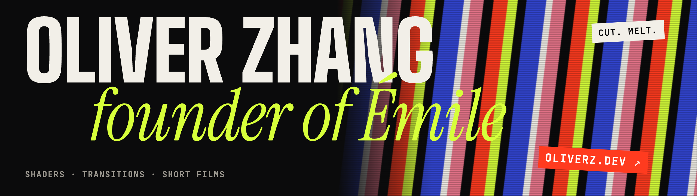

I'm building **[Émile](https://emilefilm.com)**, the AI agent video editor for Mac. I write its shaders and transitions by hand, and I make every video on my channel with it.

   

     

## Émile

<table>
  <tr>
    <td width="96" valign="top"></td>
    <td valign="top">
      Say what film you want, or bring your script. The agent researches, plans and draws every clip onto a real timeline, with voice-over and captions, then keeps editing with you: in the chat, on the picture or by hand. 16:9 or 9:16. Works with Claude, Codex or Gemini. 
      macOS · Rust, TypeScript · Apache 2.0 · in development · <a href="https://github.com/oliverzdev/Emile">Source</a>
    </td>
  </tr>
</table>

## Latest on oliverz.dev

<!-- BLOG-POST-LIST:START -->
- [How a lock works: why only your key turns it](https://oliverz.dev/videos/lock-and-key)
- [How QR codes work: why a torn code still scans](https://oliverz.dev/videos/qr-error-correction)
- [How planes fly: the “longer path” story is wrong](https://oliverz.dev/videos/airplane-lift)
- [How a differential works: why your wheels turn at two speeds](https://oliverz.dev/videos/differential)
<!-- BLOG-POST-LIST:END -->
